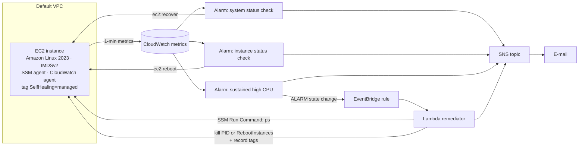

# Self-Healing EC2 on AWS

**An EC2 workload that detects its own failures and fixes them without a human, defined entirely as code.**

[](https://github.com/sainikethkosaraju/aws-self-healing-ec2/actions/workflows/ci.yml)


Different failures need different cures. Rebooting fixes a hung kernel but not dead host
hardware, and it makes a busy server worse. This stack matches each failure to the least
disruptive fix that works, and e-mails you what it did.

| Failure | Detected by | Automatic response |
|---|---|---|
| AWS host hardware, power or network fault | `StatusCheckFailed_System` (2 × 1 min) | **EC2 auto-recovery**: the instance moves to healthy hardware and keeps its ID, IP, volumes and metadata |
| Guest OS hung (kernel panic, broken networking, out of memory) | `StatusCheckFailed_Instance` (3 × 1 min) | **Reboot** |
| Runaway process saturating the CPU | `CPUUtilization ≥ 90%` (5 × 1 min) | **Lambda remediator**: asks the instance over SSM what is using the CPU, **kills** it if it is on an allow-list, otherwise **reboots**. A cooldown prevents reboot loops. |
| Instance lost entirely *(Auto Scaling mode)* | ASG health check | **Replacement** instance launched from the same template |

Every alarm transition and every remediation is e-mailed through SNS.

## Architecture



In **auto-scaling-group** mode the same launch template runs inside an Auto Scaling Group
(min = max = 1, spread across AZs). The ASG replaces the instance if it fails EC2 health checks,
and the CPU alarm tracks the group instead of a fixed instance ID.

### Design decisions

* **Diagnose before rebooting.** High CPU is often legitimate. The remediator collects the top
  processes first, and only reboots when the culprit is unknown or diagnostics fail.
* **Blast radius limited by IAM.** The Lambda can reboot, tag and run commands *only* on
  instances tagged `SelfHealing=managed`, and cannot stop or terminate anything.
* **No open ports.** The security group has no inbound rules. Access and diagnostics go
  through SSM, and the instance metadata service requires IMDSv2 tokens.
* **No loops.** The last remediation time is stored as an instance tag, and a configurable
  cooldown (default 30 min) hands repeat failures back to the status-check alarms.
* **Deployable in one command, removable in one command.** Everything is one CloudFormation stack.

## Repository

```
template.yaml            CloudFormation: instance or ASG, alarms, SNS, EventBridge, Lambda, IAM
lambda/remediator.py     diagnose-then-remediate logic
scripts/deploy.sh        package the Lambda and deploy the stack
scripts/simulate.sh      inject failures over SSM: cpu, cpu-java, hang, replace
scripts/destroy.sh       delete everything
tests/                   template contract tests + remediator tests against simulated AWS (moto)
docs/runbook.md          how to verify each self-healing path on a live account
docs/original-2025.md    the original console-built version, with its screenshots
```

## Quick start

```bash
./scripts/deploy.sh you@example.com                       # confirm the SNS e-mail afterwards
./scripts/simulate.sh cpu                                 # a runaway process appears...
# ~5 min later: alarm → Lambda kills the process → e-mail with the diagnosis
./scripts/destroy.sh
```

Parameters (all have defaults): `DeploymentMode` (`single-instance` | `auto-scaling-group`),
`InstanceType`, `CpuThreshold`, `CpuEvaluationMinutes`, `RemediationCooldownMinutes`,
`KillableProcesses`.

**Cost:** one `t3.micro` with detailed monitoring and four alarms comes to a few dollars a
month outside the free tier. Lambda, EventBridge and SNS e-mail at this volume fall within
the free tiers. Destroy the stack when you are done.

## Testing

```bash
pip install -r requirements-dev.txt
cfn-lint template.yaml          # validates every resource against the AWS specification
pytest -q                       # 16 tests
```

* **Template contract tests** check what the template promises: recovery is wired only to the
  system status check, the CPU alarm never acts blindly, IAM is limited to tagged instances
  and cannot stop or terminate, and IMDSv2 is enforced with no inbound ports.
* **Remediator tests** run the Lambda against moto-simulated EC2, SSM, SNS and Auto Scaling.
  They cover killing an allow-listed process (the exact `yes > /dev/null` fault from the
  original demo), rebooting for an unknown process, rebooting when diagnostics fail, the
  cooldown, and resolving instances behind an ASG.

## Project history

**Original (April 2025, course project, CSD462 Virtualization and Cloud Computing).** Built by
hand in the AWS console: an EC2 instance, one CloudWatch alarm (`CPUUtilization ≥ 1`), an EC2
alarm action and an SNS e-mail. It was demonstrated end to end; see the redacted screenshots in
[docs/original-2025.md](docs/original-2025.md). The account was later closed, and no
configuration was exported.

**This version (2026).** A rebuild as infrastructure-as-code. It adds true auto-recovery,
status-check reboots, the diagnose-then-remediate Lambda, cooldowns, least-privilege IAM, the
Auto Scaling mode and tests. These address the original's limitations, explained in the
history document.

**Verification status.** The template is validated with `cfn-lint` and the logic is tested
against simulated AWS APIs. The rebuilt stack has not yet been run on a live account. The
[runbook](docs/runbook.md) lists the expected behaviour for each failure, to be confirmed
and recorded on deployment.

## License

MIT. See [LICENSE](LICENSE).
