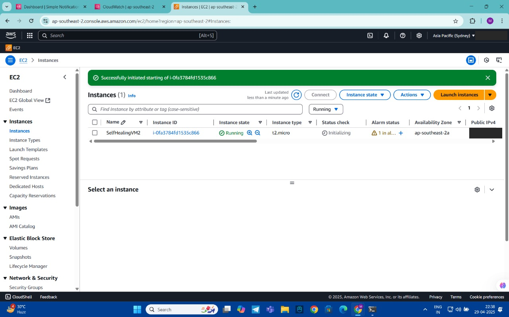
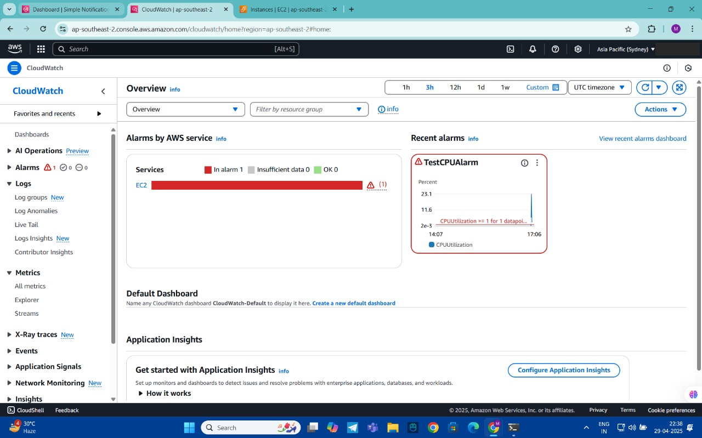
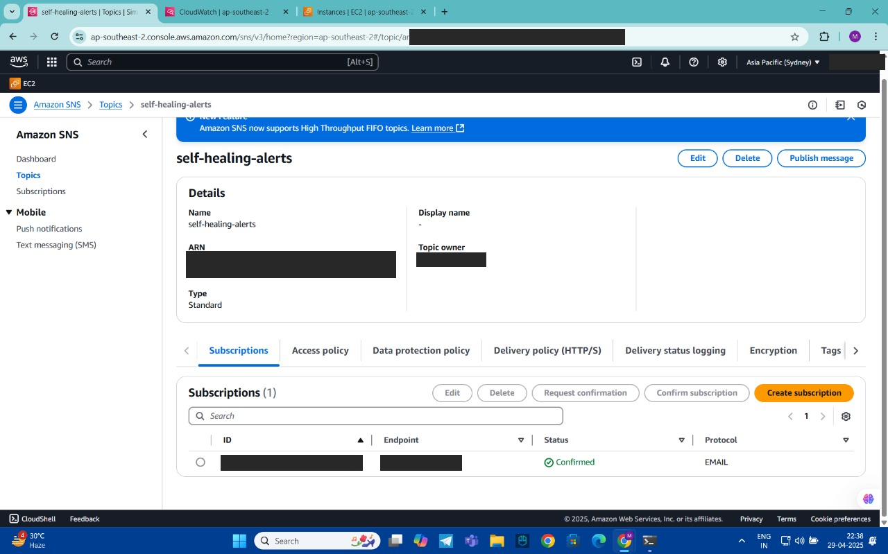
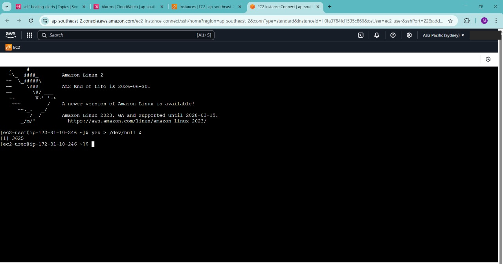
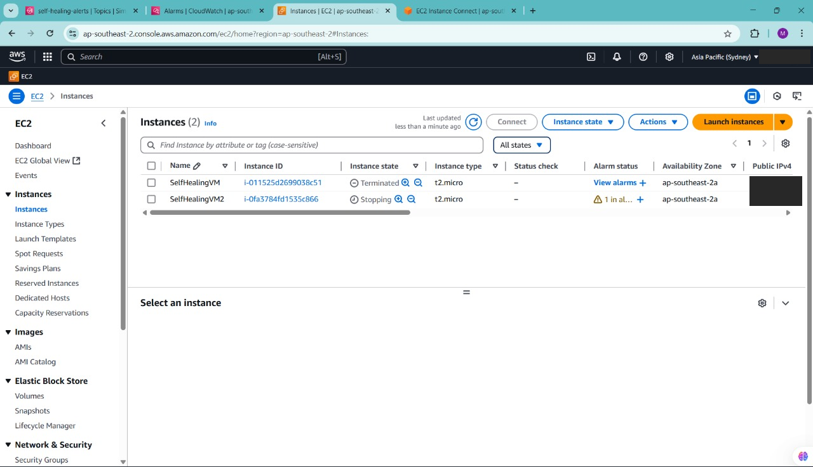
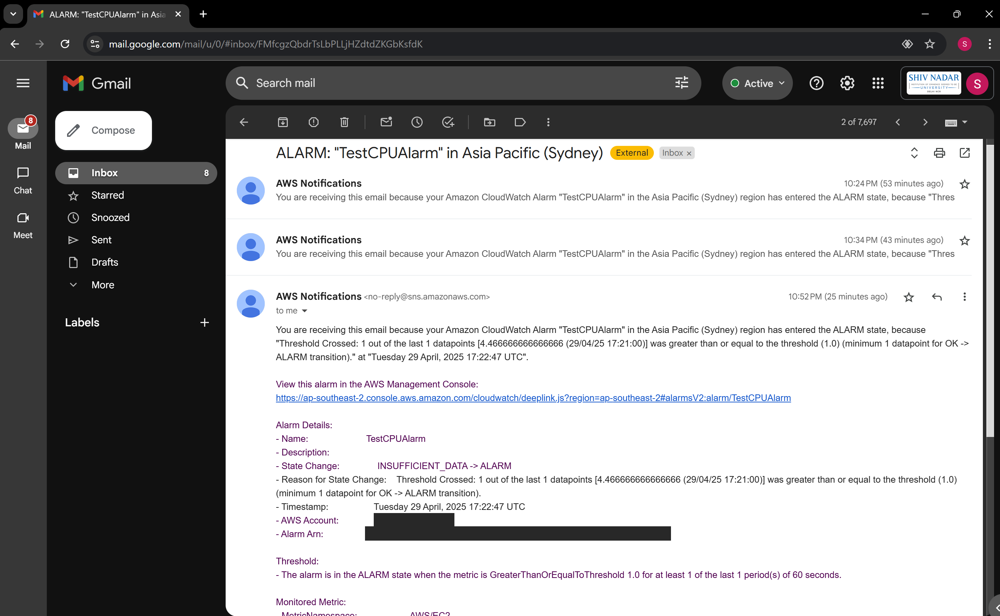

# The original 2025 build

This project began as the second project of *Virtualization and Cloud Computing (CSD462)* at
Shiv Nadar University, built in April 2025 in an AWS account (Sydney, `ap-southeast-2`) that
has since been closed. Everything was configured by hand in the AWS console, so no code or
templates survived. This page records exactly what was built, using the course report and
the screenshots taken at the time. Account IDs, ARNs, e-mail addresses and IPs are redacted.

## What was built

| Step | Original configuration |
|---|---|
| Compute | EC2 `t2.micro`, Amazon Linux 2, EBS-backed, detailed (1-minute) monitoring enabled at launch |
| Detection | CloudWatch alarm `TestCPUAlarm`: `CPUUtilization >= 1` for 1 of 1 one-minute periods |
| Action | EC2 alarm action on the instance, plus SNS topic `self-healing-alerts` |
| Notification | E-mail subscription to the topic (confirmed) |
| Fault injection | `yes > /dev/null &` over EC2 Instance Connect to spike the CPU |

## Evidence

| | |
|---|---|
|  |  |
| Instance `SelfHealingVM2` running with an alarm attached | `TestCPUAlarm` in ALARM after the CPU spike |
|  |  |
| SNS topic with a confirmed e-mail subscription | Fault injected with `yes > /dev/null &` |
|  |  |
| The alarm action takes the instance down automatically | The SNS alert e-mail (alarm fired at 17:22:47 UTC, CPU 4.47% ≥ 1.0) |

## What it demonstrated, and what it did not

It worked end to end: a metric crossed a threshold, CloudWatch changed state, an automated EC2
action ran without human input, and an e-mail arrived. That is the core control loop of any
self-healing system.

Looking back, three things limit it as *self-healing*, and they shaped the rebuild:

1. **The action was a stop, not a recovery.** Screenshot 5 shows the instance going to
   `Stopping`. The course report describes this as "recovery" and a "reboot". On AWS, true
   auto-recovery (`ec2:recover`) can only be attached to the `StatusCheckFailed_System`
   metric. CPU alarms can only stop, terminate or reboot. The rebuild wires recovery to the
   system status check, which is the failure it was designed for.
2. **CPU ≥ 1% is a demo threshold, not a health signal.** Idle instances cross it. High CPU
   is also often legitimate load, and rebooting a busy machine can turn a slow service into
   a dead one. The rebuild treats sustained CPU as a reason to *diagnose* first.
3. **One alarm, one action, no memory.** Nothing stopped a flapping alarm from rebooting the
   instance repeatedly. The rebuild adds a cooldown, an allow-list of processes it may kill,
   and a record (instance tags) of what it last did.

The report's "future scope" listed Auto Scaling Groups and Lambda-driven remediation. Both are
implemented in the rebuild.
